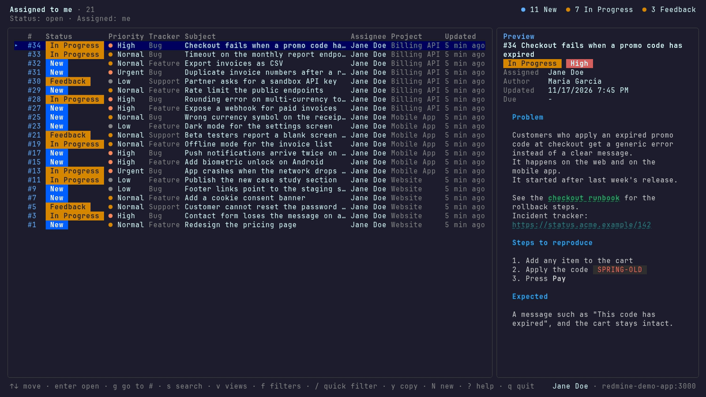
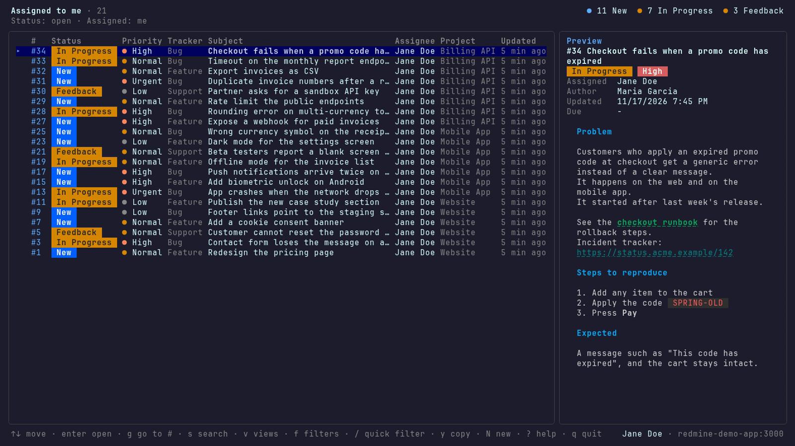
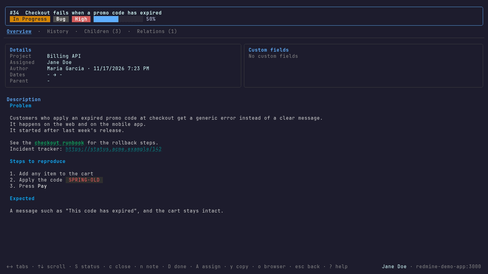
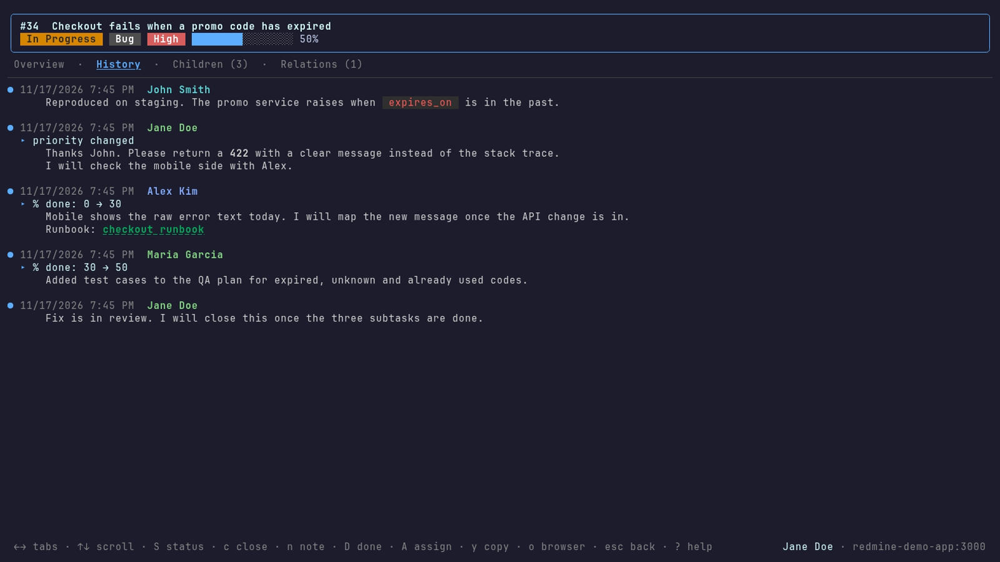
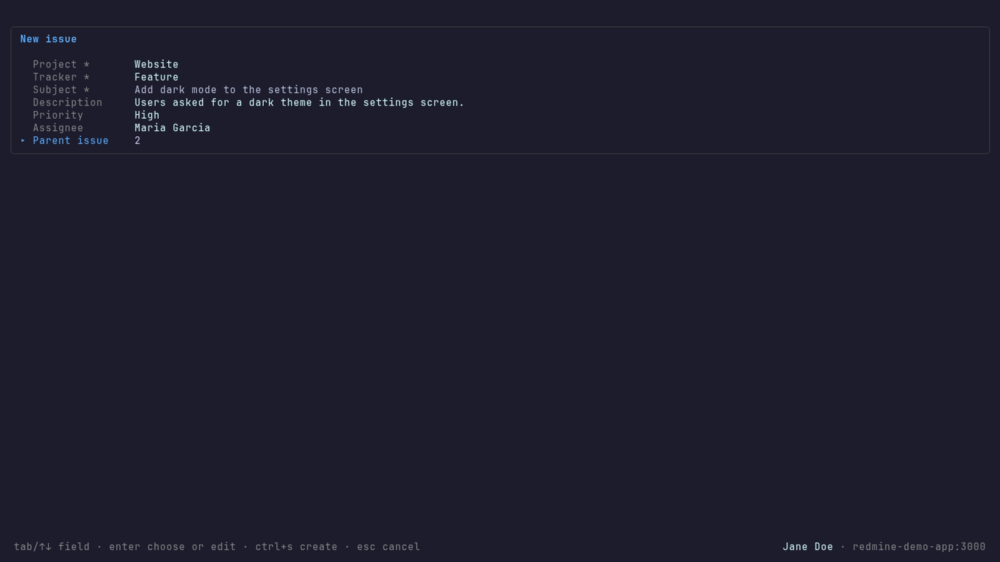

# redmine-tui

[English](README.md) | **Español**

Navega y actualiza issues de [Redmine](https://www.redmine.org) desde la terminal. Hecho con
[Bubble Tea](https://github.com/charmbracelet/bubbletea) (librerías v2 de Charm).



## Qué es y por qué

La interfaz web de Redmine es lenta cuando solo quieres ver qué tienes pendiente, saltar al issue
#1234, pasar un ticket a "Resuelta" y dejar una nota. `redmine-tui` lo hace sin salir de la
terminal, también por SSH:

- Una tabla de issues con vistas (asignados a mí, creados por mí, observados, todos, por usuario,
  por proyecto) y un panel de filtros que se envían a Redmine, así que funcionan en instancias
  grandes.
- Detalle del issue con descripción, historial, hijas y relaciones.
- Búsqueda de texto completo e "ir al issue #N".
- Acciones de escritura con una confirmación que muestra el cambio exacto: estado, notas,
  porcentaje hecho, asignado, cierre rápido e issues nuevos.
- Un modo de solo lectura estricto.
- Interfaz en inglés y español.

Usa la API REST estándar de Redmine y nada más.

| Lista con vista previa | Detalle del issue |
|---|---|
|  |  |

| Historial | Issue nuevo |
|---|---|
|  |  |

## Instalación

```bash
go install github.com/villcabo/redmine-tui@latest
```

Cada [release](https://github.com/villcabo/redmine-tui/releases) trae binarios para Linux, macOS y
Windows (amd64 y arm64), con un `checksums.txt`.

Para compilar desde el código (Go 1.27 o superior; con un Go más viejo, `GOTOOLCHAIN=auto` baja la 1.27 solo):

```bash
git clone https://github.com/villcabo/redmine-tui.git
cd redmine-tui
go build -o redmine-tui .
```

## Configuración paso a paso

Necesitas dos cosas: la dirección de tu Redmine y tu API key.

1. **Habilita la API REST** (lo hace un administrador una sola vez): *Administración →
   Configuración → API → Habilitar el servicio web REST*.
2. **Busca tu key**: *Mi cuenta → Clave de acceso a la API → Mostrar*.
3. **Guarda la key en un archivo que solo tú puedas leer.** Este comando no deja la key en el
   historial de la shell ni en `ps`:

   ```bash
   mkdir -p ~/.config/redmine && chmod 700 ~/.config/redmine
   (umask 077; read -rs 'k?API key: ' && printf 'X-Redmine-API-Key: %s\n' "$k" > ~/.config/redmine/api-key-header; unset k; echo)
   ```

   (`read -rs 'k?texto'` es de zsh. En bash usa `read -rsp 'API key: ' k`.)

   El archivo puede tener solo la key en una línea, o `X-Redmine-API-Key: <key>`. Sus permisos
   deben ser `600` (o `400`); si no, la aplicación no arranca.
4. **Dile a la aplicación dónde está Redmine.** Ejecuta el asistente:

   ```bash
   redmine-tui init
   ```

   que pregunta la URL y el idioma, escribe `~/.config/redmine-tui/config.toml` y explica el paso
   de la key (o, si lo pides, la lee con entrada oculta y la guarda con permisos 0600), o exporta
   la URL tú mismo:

   ```bash
   export REDMINE_URL=https://redmine.example.com
   ```
5. Ejecuta `redmine-tui`.

### Referencia de configuración

Prioridad, de mayor a menor: **opciones de línea de comandos, variables de entorno, archivo de
configuración, valores por defecto.**

| Ajuste | Opción | Entorno | Clave del archivo | Por defecto |
|---|---|---|---|---|
| URL de Redmine (obligatoria) | `--url` | `REDMINE_URL` | `url` | ninguno |
| Archivo de la key | `--key-file` | `REDMINE_HEADER_FILE` (alias `REDMINE_API_KEY_FILE`) | `key_file` | `~/.config/redmine/api-key-header` |
| Idioma `en` / `es` | `--lang` | `REDMINE_TUI_LANG` | `language` | según `LC_ALL`, `LC_MESSAGES`, `LANG`; si no, `en` |
| Solo lectura | `--read-only` | `REDMINE_READ_ONLY=1` | `read_only` | desactivado |
| Editor para las notas | | `EDITOR`, `VISUAL` | `editor` | `vi` |
| Ruta del archivo de configuración | `--config` | `XDG_CONFIG_HOME` | | `~/.config/redmine-tui/config.toml` |
| Sin colores | | `NO_COLOR` | | colores activados |

El editor es la única excepción al orden anterior: la clave `editor` del archivo gana sobre
`EDITOR` y `VISUAL`, porque es un ajuste hecho para esta herramienta.

Ejemplo de `config.toml`:

```toml
url = "https://redmine.example.com"
language = "es"         # en | es
key_file = "~/.config/redmine/api-key-header"
read_only = false
editor = "nvim"         # opcional

# Opcional: colorea estados por nombre (green, blue, amber, magenta, red, gray).
[status_colors]
"En curso" = "magenta"
"Bloqueado" = "red"
```

Sin `[status_colors]` los colores son genéricos: los estados cerrados van en verde, el estado por
defecto de Redmine (o el primero de la lista) en azul, y cualquier otro estado abierto en ámbar.

## Uso

```bash
redmine-tui              # lista de los issues asignados a ti
redmine-tui 1234         # abre directo el issue #1234 (las opciones van antes del número)
redmine-tui --read-only  # sin ninguna escritura
redmine-tui --lang es    # interfaz en español
redmine-tui --version
```

Dentro de la aplicación, `?` muestra la lista de teclas.

### Teclas: lista

| Tecla | Acción |
|---|---|
| `↑` `↓` `j` `k`, `pgup` `pgdown`, `home` `end` / `G` | moverse |
| `enter` | abrir el issue |
| `g` | ir a un issue por número |
| `s` | búsqueda de texto completo |
| `v` | elegir una vista: asignados a mí, creados por mí, observados, todos, asignados a…, creados por…, por proyecto… |
| `f` | panel de filtros: proyecto, estado, tracker, asignado, autor. `enter` edita una fila, `x` la limpia, `F` limpia todo, `esc` aplica y cierra |
| `F` / `ctrl+r` | limpiar todos los filtros |
| `a` | alternar abiertos / todos los estados |
| `/` | filtro rápido de texto sobre las filas cargadas (`esc` lo quita) |
| `p` | alternar el panel de vista previa (se muestra desde 140 columnas) |
| `O` | cambiar el orden: actualizado (por defecto), vencimiento, prioridad, creado. Vencimiento lista solo los issues que tienen fecha, porque Redmine pone primero los que no tienen, y agrega una columna Vence |
| `S` `c` `n` `D` `A` | estado, cierre rápido, nota, porcentaje hecho y asignar sobre la fila elegida, sin abrirla. Primero se pide el issue, por los estados que permite su flujo |
| `y` | copiar: enlace, `#id`, título, `#id título` |
| `→` `l` / `←` `h` / `space` | desplegar / plegar las hijas de la fila: `+3` marca un issue con 3 hijas, `−3` uno desplegado |
| `N` | issue nuevo |
| `o` | abrir en el navegador |
| `r` | recargar |
| `?` | ayuda |
| `q` / `ctrl+c` | salir |

Las listas largas cargan 100 issues y piden la página siguiente al llegar al final; el encabezado
muestra "100 de 340". Si la terminal es angosta, la tabla oculta primero la columna Proyecto,
después Tracker y por último Prioridad. En "asignados a mí" no se muestra la columna Asignado,
porque repetiría tu nombre en cada fila; vuelve mientras haya una fila desplegada. Un nombre de
proyecto largo del tipo "Padre - Hijo" muestra su última parte. Recargar deja el cursor en el mismo
issue.

Desplegar una fila muestra todo su subárbol, a cualquier profundidad y en cualquier estado, con las
mismas columnas. La vista previa muestra el porcentaje hecho, el vencimiento (rojo si está vencido,
ámbar si vence en dos días o menos) y cuántas hijas están cerradas.

### Teclas: detalle del issue

| Tecla | Acción |
|---|---|
| `tab` `shift+tab` `←` `→` | cambiar de pestaña (Detalle, Historial, Hijas, Relaciones) |
| `↑` `↓` `j` `k`, `pgup` `pgdown`, `home`, `G` | desplazarse o moverse en las listas |
| `enter` | abrir la hija o relación elegida |

El detalle abre al instante con lo que ya se sabe por la lista (o por una visita anterior) y se marca
"actualizando…" hasta que llega el issue completo. Versión, categoría y horas estimadas o gastadas
aparecen solo cuando la instancia las informa.

La pestaña Hijas dibuja todo el árbol bajo el issue, nietas incluidas, con estado, prioridad,
tracker y asignado; Relaciones muestra el asunto y el estado del otro issue.
| `S` | cambiar el estado (solo los que permite el flujo de trabajo), con una nota opcional |
| `c` | cierre rápido: un estado cerrado, porcentaje hecho 100, nota opcional |
| `n` | agregar una nota (`$EDITOR`, o un área de texto de la aplicación si no hay editor) |
| `D` | cambiar el porcentaje hecho (0 a 100 de 10 en 10) |
| `A` | asignar: a mí, a un miembro del proyecto, o sin asignar |
| `g` `s` `y` `o` `r` | ir a, buscar, copiar, navegador, recargar |
| `esc` / `backspace` | volver |

### Formulario de issue nuevo

`N` en la lista abre el formulario: proyecto, tracker (del proyecto), asunto (obligatorio),
descripción (editor o área de texto), prioridad, asignado, issue padre y los **campos
personalizados obligatorios** del proyecto. `tab` / `↑` `↓` cambia de campo, `enter` abre un
selector o el editor, `ctrl+s` muestra un resumen y pide confirmación, `esc` cancela. Si Redmine
responde 422, el formulario queda como estaba y se muestran los mensajes de Redmine.

### Búsqueda

`s` pide un texto y lista los issues que coinciden (`GET /search.json`). `enter` abre uno, `esc`
vuelve.

## Modo solo lectura

`--read-only`, `REDMINE_READ_ONLY=1` o `read_only = true` desactivan toda escritura. Las teclas de
escritura responden "Modo solo lectura: las escrituras están desactivadas", la barra de estado
muestra **SOLO LECTURA**, y el propio cliente HTTP se niega a enviar un `PUT` o un `POST`, así que
un error en la interfaz tampoco podría escribir.

## Seguridad

- **La API key nunca se acepta como argumento ni como valor de una variable de entorno.** Quedaría
  en el historial de la shell y en `ps`. Solo se lee desde un archivo.
- El archivo de la key debe tener permisos `600` o `400`; si no, la aplicación no arranca y dice
  cómo corregirlo.
- La key se enmascara al formatear el header, se quita de todos los mensajes de error y nunca va
  en una URL.
- **Las redirecciones no se siguen.** Go reenviaría el header `X-Redmine-API-Key` al nuevo destino,
  incluso en otro host, así que seguir una podría entregar tu key a un tercero.
- **Las escrituras se limitan a `PUT /issues/:id.json` y `POST /issues.json`.** No existe `DELETE`
  ni escritura sobre usuarios, proyectos o campos personalizados; el cliente rechaza cualquier
  otra escritura.
- **Toda escritura muestra una confirmación con el cambio exacto** (por ejemplo *¿Cambiar #123 de
  «En curso» a «Cerrado»? [s/N]*) y cancela por defecto: solo `s` confirma (`y` en inglés).
- **Una escritura que agota el tiempo o falla por la red no se reintenta.** La aplicación dice "No
  se sabe si se aplicó; recargá para verificar", porque pudo haberse aplicado.
- Usa la key de una cuenta con los permisos que necesitas y no más. Una key de administrador deja
  leer más cosas a la aplicación (por ejemplo las definiciones de campos personalizados), pero
  también deja cambiar más.

## Compatibilidad

Funciona con Redmine estándar **5.x y 6.x**. La API REST debe estar habilitada (*Administración →
Configuración → API*).

Comportamiento que depende de la versión y de los permisos:

- **Los estados permitidos** salen de `GET /issues/:id.json?include=allowed_statuses` (Redmine
  5.0+). Sin eso, la aplicación lista todos los estados y te avisa.
- **Los campos personalizados obligatorios del formulario** necesitan `GET /custom_fields.json`,
  que Redmine solo entrega a administradores. Sin eso se ofrecen como texto opcional todos los
  campos habilitados en el proyecto, y Redmine indica con un 422 cuáles necesita. Los campos de
  lista con valores múltiples envían un solo valor.
- **La búsqueda de usuarios** (asignados a…, creados por…, filtros de autor y asignado) usa
  `GET /users.json`, solo para administradores. Ante un 403 la aplicación lista los miembros de los
  proyectos que puedes ver (hasta 200 proyectos), lo avisa y los guarda en memoria durante la
  sesión.
- **Asignar** ofrece solo usuarios; los grupos no se ofrecen aunque tu instancia permita asignar a
  grupos, porque la API no informa si lo permite.
- **El porcentaje hecho** lo ignora Redmine cuando la instancia lo calcula a partir del estado.
- El panel de vista previa usa la descripción que ya trae la lista; no hace ninguna consulta
  adicional.
- Las hijas cuestan lecturas, nunca escrituras: un `GET /issues.json?parent_id=…` por página de la
  lista para las marcas `+n`, un `parent_id=~id` por fila desplegada y, en el detalle, uno para el
  árbol y un `issue_id=…` para las relaciones. Las hijas que la key no puede ver no se cuentan.
- La búsqueda se limita a los primeros 500 resultados.
- **Los campos personalizados de usuario** llegan de Redmine como un id. El detalle muestra el nombre
  solo si la key puede leer las definiciones de campos (`GET /custom_fields.json`, solo para
  administradores) y el usuario (`GET /users/:id.json`); si no, muestra el id. Los campos de fecha
  usan el formato de la interfaz.

## Preguntas frecuentes y problemas comunes

**`falta la URL de Redmine`**: exporta `REDMINE_URL`, usa `--url` o ejecuta `redmine-tui init`.

**`Redmine no aceptó la API key (401)`**: la key es incorrecta o fue revocada, o la API REST está
deshabilitada. Revisa *Mi cuenta → Clave de acceso a la API* y *Administración → Configuración →
API*.

**`Sin permiso para esto (403)`**: tu cuenta no puede ver ese proyecto o usar esa acción. La lista
de usuarios también da 403 a quienes no son administradores; ese caso está resuelto (mira
Compatibilidad).

**`El recurso no existe o no hay acceso a él (404)`**: número de issue equivocado, o el issue está
en un proyecto que tu key no ve. Una `REDMINE_URL` incorrecta (por ejemplo sin el subdirectorio
`/redmine`) también da 404.

**`el archivo ... tiene permisos 0644 (ejecuta chmod 600 ...)`**: ejecuta `chmod 600` sobre el
archivo de la key.

**`Redmine respondió con una redirección y no se sigue`**: la URL redirige, normalmente de `http` a
`https` o a otro host. Usa la URL final en `REDMINE_URL`.

**La lista de estados muestra todos los estados y una advertencia**: tu Redmine no informa
`allowed_statuses` (antes de la 5.0). Redmine igual rechazará las transiciones que el flujo de
trabajo no permita.

**`g` no va al inicio de la lista**: `g` ahora abre "ir al issue". Usa `home`.

**No se copia al portapapeles por SSH**: copiar usa la secuencia de escape OSC 52. Tu terminal debe
permitirla (kitty, WezTerm, iTerm2, Alacritty y tmux reciente con `set -g set-clipboard on`).

**Los colores se ven mal**: define `NO_COLOR=1` para quitarlos, o asigna colores por nombre de
estado en `[status_colors]`.

## Cómo contribuir

Los issues y los pull requests son bienvenidos.

Corré los chequeos en local antes de abrir un pull request:

```bash
gofmt -l . && go vet ./... && go test ./... && go build ./...
```

- La CI no corre en los pull requests: corre en `main` después de que el mantenedor revisa y
  mergea, así el código de un fork nunca se ejecuta en los runners del proyecto antes de revisarlo.
- Los releases los publica el mantenedor: un tag `v*` más la aprobación del environment `release`.

- Los tests usan `httptest`; nunca contactan un Redmine real ni necesitan una key.
- Todo texto visible pasa por `internal/i18n`: agrega la clave en **ambos** `en.go` y `es.go` (un
  test falla si los catálogos difieren o si falta una clave usada en el código).
- Mantén las garantías de seguridad de arriba; no se aceptará un cambio que agregue una petición
  distinta de una lectura, `PUT /issues/:id.json` o `POST /issues.json`.
- Usa [Conventional Commits](https://www.conventionalcommits.org/es/) en los mensajes.

### Generar las capturas

Las imágenes de `docs/` son capturas reales de la app corriendo contra un **Redmine de demostración
descartable con datos ficticios** (empresa "Acme", usuarios y proyectos inventados). Nunca apuntes
esto a una instancia real.

1. Levanta un Redmine de demo en Docker, publicado solo en localhost:
   `docker run -d --rm --restart no -p 127.0.0.1:3999:3000 redmine:6`. Carga los datos por defecto
   (`bundle exec rake redmine:load_default_data RAILS_ENV=production REDMINE_LANG=en`), habilita la
   API REST y crea con un script de `bundle exec rails runner` unos proyectos y usuarios ficticios
   y unos 30 issues. Un issue necesita notas, cambios de estado, hijas y una relación para las
   capturas de detalle e historial.
2. Escribe la key del usuario de demo en un archivo con permisos 600 (`X-Redmine-API-Key: <key>`)
   y compila un binario estático: `CGO_ENABLED=0 GOOS=linux GOARCH=amd64 go build -o redmine-tui .`
3. Corre [VHS](https://github.com/charmbracelet/vhs) en Docker (`ghcr.io/charmbracelet/vhs`, que ya
   trae ttyd y ffmpeg) en la misma red de Docker que el Redmine de demo, con el binario montado en
   `/usr/local/bin/redmine-tui`, la key montada de solo lectura y una copia de `docs/demo.tape`
   cuyo `REDMINE_URL` apunte al contenedor de demo.
4. Borra los contenedores, la red y la key al terminar.

## Autor

<a href="https://github.com/villcabo"></a>

**Bismarck Villca Soliz**

[](https://villcabo.github.io/)
[](https://github.com/villcabo)
[](https://www.linkedin.com/in/villcabo/)
[](https://www.facebook.com/bismarck.villca)
[](mailto:bismarck.villca@gmail.com)

<br clear="left" />

## Licencia

[MIT](LICENSE)
