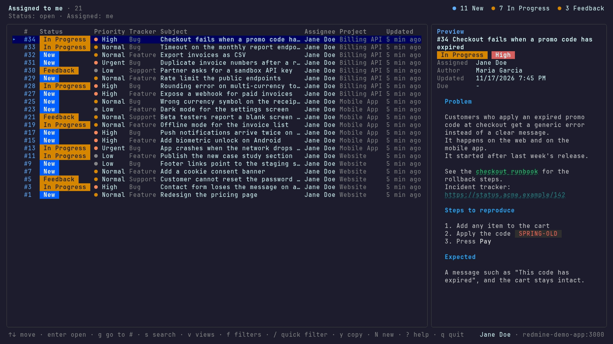
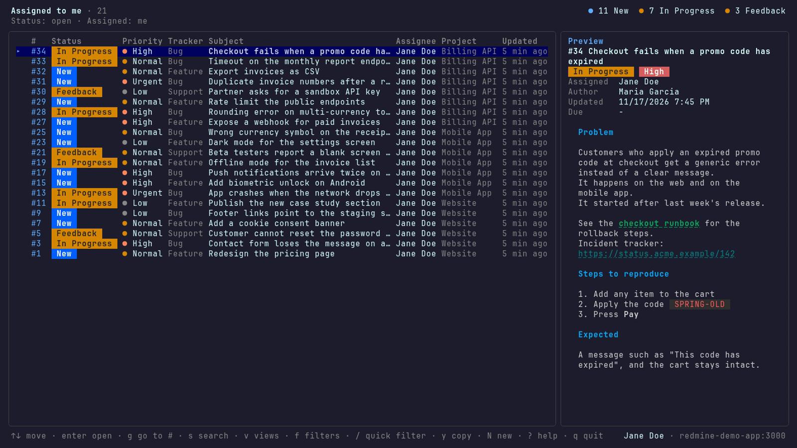
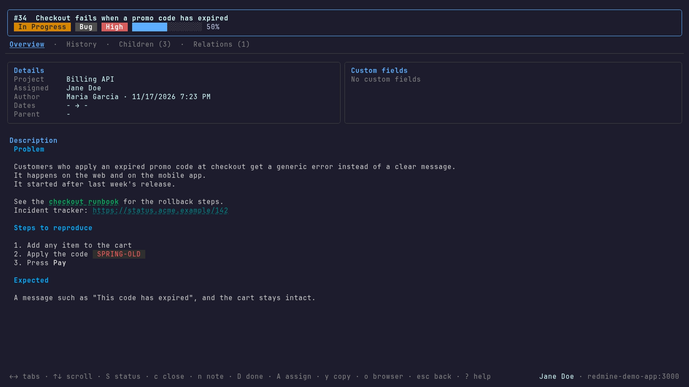
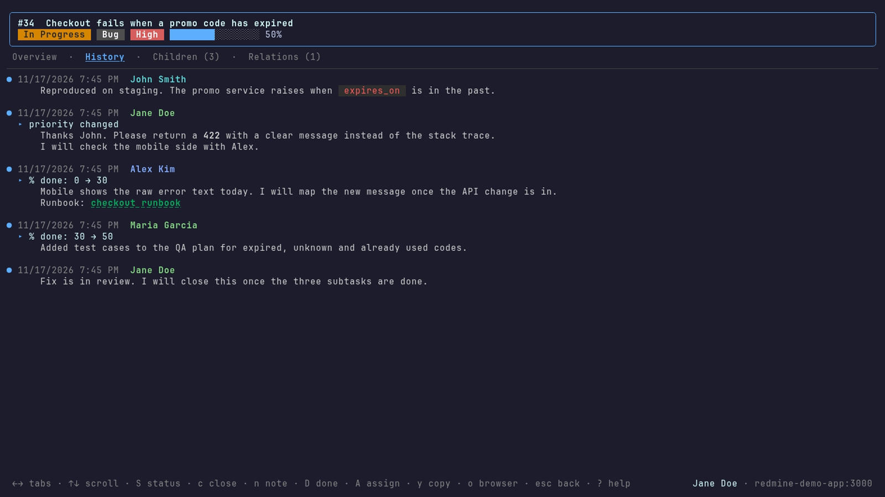
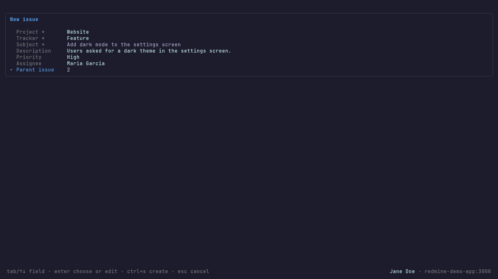

# redmine-tui

**English** | [Español](README.es.md)

Browse and update [Redmine](https://www.redmine.org) issues from your terminal. Built with
[Bubble Tea](https://github.com/charmbracelet/bubbletea) (Charm v2 libraries).



## What it is and why

Redmine's web interface is slow when all you want is to check what is on your plate, jump to
issue #1234, move a ticket to "Resolved" and leave a note. `redmine-tui` does that without
leaving the terminal, over SSH too:

- A table of issues with views (assigned to me, created by me, watching, all, by user, by
  project) and a filter panel whose filters are sent to Redmine, so they work on big instances.
- Issue detail with description, history, children and relations.
- Full-text search and "go to issue #N".
- Write actions with a confirmation that shows the exact change: status, notes, percent done,
  assignee, quick close and new issues.
- A strict read-only mode.
- English and Spanish interface.

It talks to the standard Redmine REST API and nothing else.

| List with preview | Issue detail |
|---|---|
|  |  |

| History | New issue |
|---|---|
|  |  |

## Installation

```bash
go install github.com/villcabo/redmine-tui@latest
```

Pre-built binaries for Linux, macOS and Windows (amd64 and arm64) are attached to every
[release](https://github.com/villcabo/redmine-tui/releases), with a `checksums.txt`.

To build from source (Go 1.27 or newer; with an older Go, `GOTOOLCHAIN=auto` downloads 1.27 for you):

```bash
git clone https://github.com/villcabo/redmine-tui.git
cd redmine-tui
go build -o redmine-tui .
```

## Setup

You need two things: the address of your Redmine and your API key.

1. **Enable the REST API** (an administrator does this once): *Administration → Settings → API →
   Enable REST web service*.
2. **Find your key**: *My account → API access key → Show*.
3. **Store the key in a file only you can read.** This command never leaves the key in your shell
   history or in `ps`:

   ```bash
   mkdir -p ~/.config/redmine && chmod 700 ~/.config/redmine
   (umask 077; read -rs 'k?API key: ' && printf 'X-Redmine-API-Key: %s\n' "$k" > ~/.config/redmine/api-key-header; unset k; echo)
   ```

   (`read -rs 'k?prompt'` is zsh. In bash use `read -rsp 'API key: ' k`.)

   The file may contain just the key on one line, or `X-Redmine-API-Key: <key>`. Its mode must be
   `600` (or `400`), otherwise the app refuses to start.
4. **Tell the app where Redmine is.** Either run the guided setup:

   ```bash
   redmine-tui init
   ```

   which asks for the URL and the language, writes `~/.config/redmine-tui/config.toml` and
   explains the key step (or, if you ask, reads the key with hidden input and saves it with mode
   0600), or export the URL yourself:

   ```bash
   export REDMINE_URL=https://redmine.example.com
   ```
5. Run `redmine-tui`.

### Configuration reference

Priority, highest first: **flags, environment variables, config file, defaults.**

| Setting | Flag | Environment | Config key | Default |
|---|---|---|---|---|
| Redmine URL (required) | `--url` | `REDMINE_URL` | `url` | none |
| Key file | `--key-file` | `REDMINE_HEADER_FILE` (alias `REDMINE_API_KEY_FILE`) | `key_file` | `~/.config/redmine/api-key-header` |
| Language `en` / `es` | `--lang` | `REDMINE_TUI_LANG` | `language` | from `LC_ALL`, `LC_MESSAGES`, `LANG`; else `en` |
| Read-only | `--read-only` | `REDMINE_READ_ONLY=1` | `read_only` | off |
| Editor for notes | | `EDITOR`, `VISUAL` | `editor` | `vi` |
| Config file path | `--config` | `XDG_CONFIG_HOME` | | `~/.config/redmine-tui/config.toml` |
| No colors | | `NO_COLOR` | | colors on |

The editor is the one exception to the order above: the `editor` key of the config file wins over
`EDITOR` and `VISUAL`, because it is a setting made for this tool.

Example `config.toml`:

```toml
url = "https://redmine.example.com"
language = "en"          # en | es
key_file = "~/.config/redmine/api-key-header"
read_only = false
editor = "nvim"          # optional

# Optional: color statuses by name (green, blue, amber, magenta, red, gray).
[status_colors]
"In Progress" = "magenta"
"Blocked" = "red"
```

Without `[status_colors]` the colors are generic: closed statuses are green, Redmine's default
status (or the first one in the list) is blue, and every other open status is amber.

## Usage

```bash
redmine-tui              # list of the issues assigned to you
redmine-tui 1234         # open issue #1234 directly (flags go before the number)
redmine-tui --read-only  # no writes at all
redmine-tui --lang es    # Spanish interface
redmine-tui --version
```

Press `?` inside the app for the list of keys.

### Keys: list

| Key | Action |
|---|---|
| `↑` `↓` `j` `k`, `pgup` `pgdown`, `home` `end` / `G` | move |
| `enter` | open the issue |
| `g` | go to an issue by number |
| `s` | full-text search |
| `v` | choose a view: assigned to me, created by me, watching, all issues, assigned to…, created by…, by project… |
| `f` | filter panel: project, status, tracker, assignee, author. `enter` edits a row, `x` clears it, `F` clears all, `esc` applies and closes |
| `F` / `ctrl+r` | clear every filter |
| `a` | toggle open / all statuses |
| `/` | quick text filter over the loaded rows (`esc` clears it) |
| `p` | toggle the preview panel (shown from 140 columns) |
| `O` | change the order: updated (default), due date, priority, created. Due date lists only issues that have one, because Redmine puts undated issues first, and adds a Due column |
| `S` `c` `n` `D` `A` | status, quick close, note, percent done, assign, on the selected row, without opening it. The issue is fetched first, for its workflow statuses |
| `y` | copy: link, `#id`, title, `#id title` |
| `→` `l` / `←` `h` / `space` | expand / collapse the children of the row: `+3` marks an issue with 3 children, `−3` an expanded one |
| `N` | new issue |
| `o` | open in the browser |
| `r` | reload |
| `?` | help |
| `q` / `ctrl+c` | quit |

Long lists load 100 issues at a time and fetch the next page when you reach the end; the header
shows "100 of 340". When the terminal is narrow the table hides the Project column first, then
Tracker, then Priority. In "assigned to me" the Assignee column is left out, since it would repeat
your name on every row; it comes back while a row is expanded. A long "Parent - Child" project name
shows its last part. Reloading keeps the cursor on the same issue.

Expanding a row shows its whole subtree, at any depth and in any status, with the same columns.
The preview shows percent done, the due date (red when overdue, amber within two days) and how
many children are closed.

### Keys: issue detail

| Key | Action |
|---|---|
| `tab` `shift+tab` `←` `→` | switch tab (Overview, History, Children, Relations) |
| `↑` `↓` `j` `k`, `pgup` `pgdown`, `home`, `G` | scroll or move in the lists |
| `enter` | open the selected child or relation |

The detail opens at once with what the list (or an earlier visit) already knows and marks itself
"updating…" until the full issue arrives. Version, category and estimated/spent hours appear only
when the instance reports them.

The Children tab draws the whole tree below the issue, grandchildren included, with status,
priority, tracker and assignee; Relations shows the subject and status of the other issue.
| `S` | change status (only the statuses the workflow allows), with an optional note |
| `c` | quick close: a closed status, percent done 100, optional note |
| `n` | add a note (`$EDITOR`, or an in-app text area if there is no editor) |
| `D` | set percent done (0 to 100 in steps of 10) |
| `A` | assign: to me, to a project member, or unassigned |
| `g` `s` `y` `o` `r` | go to, search, copy, browser, reload |
| `esc` / `backspace` | back |

### New issue form

`N` in the list opens the form: project, tracker (from the project), subject (required),
description (editor or text area), priority, assignee, parent issue and the project's **required
custom fields**. `tab` / `↑` `↓` moves between fields, `enter` opens a picker or the editor,
`ctrl+s` shows a summary and asks for confirmation, `esc` cancels. If Redmine answers 422 the form
stays as it was and Redmine's messages are shown.

### Search

`s` asks for text and lists matching issues (`GET /search.json`). `enter` opens one, `esc` goes
back.

## Read-only mode

`--read-only`, `REDMINE_READ_ONLY=1` or `read_only = true` disable every write. The write keys
answer "Read-only mode: writes are disabled", the status bar shows **READ ONLY**, and the HTTP
client itself refuses to send a `PUT` or `POST`, so a bug in the interface could not write either.

## Security

- **The API key is never accepted as an argument or as the value of an environment variable.**
  That would leave it in your shell history and in `ps`. It only comes from a file.
- The key file must have mode `600` or `400`; otherwise the app does not start and tells you how
  to fix it.
- The key is masked whenever the header is formatted, removed from every error message, and never
  placed in a URL.
- **Redirects are never followed.** Go would forward the `X-Redmine-API-Key` header to the new
  location, even on another host, so following one could hand your key to a third party.
- **Writes are limited to `PUT /issues/:id.json` and `POST /issues.json`.** There is no `DELETE`
  and no write to users, projects or custom fields; the client rejects any other write.
- **Every write shows a confirmation with the exact change** (for example *Change #123 from
  "In progress" to "Closed"? [y/N]*) and cancels by default: only `y` confirms (`s` in Spanish).
- **A write that times out or fails on the network is not retried.** The app says "It is not known
  whether the change was applied; reload to verify", because it may have been applied.
- Use a key from an account with the permissions you need and no more. An administrator key lets
  the app read more (for example the custom field definitions), but also lets you change more.

## Compatibility

Works with standard Redmine **5.x and 6.x**. The REST API must be enabled (*Administration →
Settings → API*).

Version and permission dependent behavior:

- **Allowed statuses** come from `GET /issues/:id.json?include=allowed_statuses` (Redmine 5.0+).
  Without it the app lists every status and warns you.
- **Required custom fields in the new issue form** need `GET /custom_fields.json`, which Redmine
  only serves to administrators. Without it every custom field enabled in the project is offered
  as optional text and Redmine tells you, with a 422, which ones it needs. List fields with
  multiple values send a single value.
- **User search** (assigned to…, created by…, author and assignee filters) uses `GET /users.json`,
  which is administrator-only. On a 403 the app lists the members of the projects you can see
  (up to 200 projects), says so, and keeps them in memory for the session.
- **Assigning** offers users only; groups are not offered even when your instance lets you assign
  to groups, because the API does not say whether it does.
- **Percent done** is ignored by Redmine when the instance derives it from the status.
- The preview panel uses the description already returned by the list; it makes no extra request.
- Children cost reads, never writes: one `GET /issues.json?parent_id=…` per list page for the
  `+n` marks, one `parent_id=~id` per expanded row, and in the detail one for the tree and one
  `issue_id=…` for the relations. Children the key cannot see are not counted.
- Search is limited to the first 500 results.
- **User custom fields** come from Redmine as a user id. The detail shows the name only when the
  key may read the field definitions (`GET /custom_fields.json`, administrator-only) and the user
  (`GET /users/:id.json`); otherwise it shows the id. Date custom fields use the interface format.

## FAQ and troubleshooting

**`the Redmine URL is not set`**: export `REDMINE_URL`, pass `--url`, or run `redmine-tui init`.

**`Redmine did not accept the API key (401)`**: the key is wrong or revoked, or the REST API is
disabled. Check *My account → API access key* and *Administration → Settings → API*.

**`No permission for this (403)`**: your account cannot see that project or use that action. The
user list also gives 403 for non administrators; that one is handled (see Compatibility).

**`The resource does not exist or is not accessible (404)`**: wrong issue number, or the issue is
in a project your key cannot see. A wrong `REDMINE_URL` (for example a missing sub-path such as
`/redmine`) also gives 404.

**`the file ... has mode 0644 (run chmod 600 ...)`**: run `chmod 600` on the key file.

**`Redmine answered with a redirect, which is not followed`**: the URL redirects, usually from
`http` to `https` or to another host. Use the final URL in `REDMINE_URL`.

**The status list shows every status and a warning**: your Redmine does not report
`allowed_statuses` (before 5.0). Redmine will still reject transitions the workflow forbids.

**`g` does not go to the top of the list**: `g` now opens "go to issue". Use `home`.

**No clipboard over SSH**: copying uses the OSC 52 escape sequence. Your terminal must allow it
(kitty, WezTerm, iTerm2, Alacritty and recent tmux with `set -g set-clipboard on` do).

**Colors look wrong**: set `NO_COLOR=1` for no colors, or map status names in `[status_colors]`.

## Contributing

Issues and pull requests are welcome.

Run the checks locally before opening a pull request:

```bash
gofmt -l . && go vet ./... && go test ./... && go build ./...
```

- CI does not run on pull requests: it runs on `main` after the maintainer reviews and merges,
  so code from a fork never executes on the project's runners before review.
- Releases are cut by the maintainer: a `v*` tag plus an approval of the `release` environment.

- Tests use `httptest`; they never contact a real Redmine and need no key.
- User-visible text goes through `internal/i18n`: add the key to **both** `en.go` and `es.go` (a
  test fails if the catalogs differ or a key used in code is missing).
- Keep the security properties above; a change that adds a request other than a read, `PUT
  /issues/:id.json` or `POST /issues.json` will not be accepted.
- Use [Conventional Commits](https://www.conventionalcommits.org/) for messages.

### Generating the screenshots

The images in `docs/` are real captures of the app running against a **throwaway demo Redmine
with fake data** (company "Acme", fictional users and projects). Never point this at a real
instance.

1. Start a demo Redmine in Docker, bound to localhost only:
   `docker run -d --rm --restart no -p 127.0.0.1:3999:3000 redmine:6`. Load the default data
   (`bundle exec rake redmine:load_default_data RAILS_ENV=production REDMINE_LANG=en`), enable the
   REST API and create a few fictional projects, users and about 30 issues with a
   `bundle exec rails runner` script. One issue needs notes, status changes, children and a
   relation for the detail and history captures.
2. Write the demo user's key to a file with mode 600 (`X-Redmine-API-Key: <key>`) and build a
   static binary: `CGO_ENABLED=0 GOOS=linux GOARCH=amd64 go build -o redmine-tui .`
3. Run [VHS](https://github.com/charmbracelet/vhs) in Docker (`ghcr.io/charmbracelet/vhs`, which
   already ships ttyd and ffmpeg) on the same Docker network as the demo Redmine, with the binary
   mounted at `/usr/local/bin/redmine-tui`, the key file mounted read-only, and a copy of
   `docs/demo.tape` whose `REDMINE_URL` points at the demo container.
4. Delete the containers, the network and the key when done.

## Author

<a href="https://github.com/villcabo"></a>

**Bismarck Villca Soliz**

[](https://villcabo.github.io/)
[](https://github.com/villcabo)
[](https://www.linkedin.com/in/villcabo/)
[](https://www.facebook.com/bismarck.villca)
[](mailto:bismarck.villca@gmail.com)

<br clear="left" />

## License

[MIT](LICENSE)
